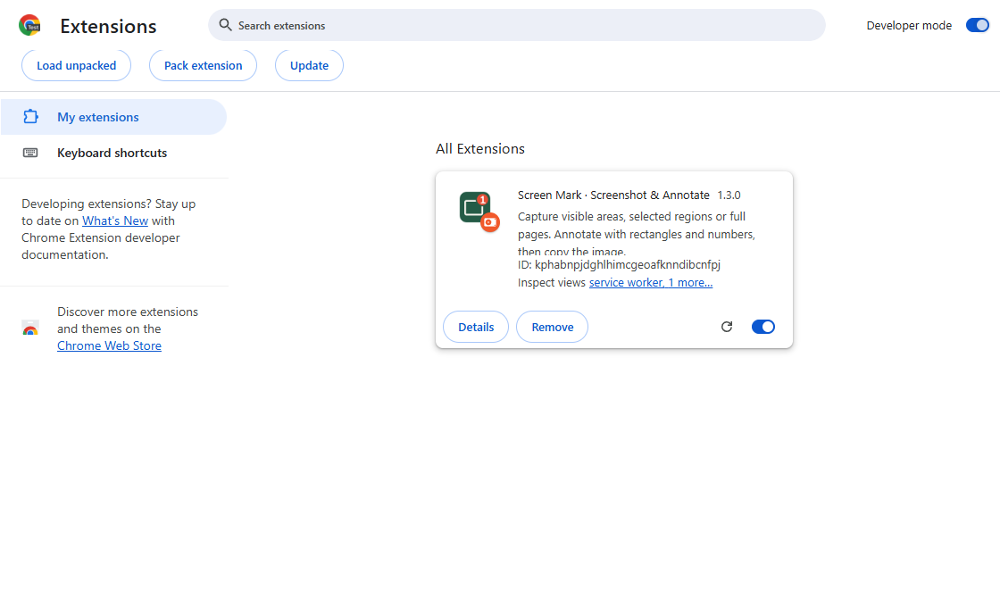
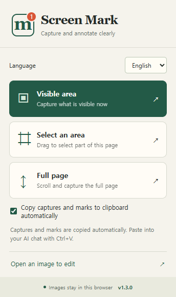
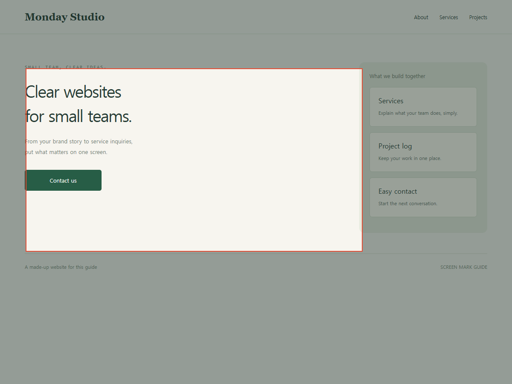
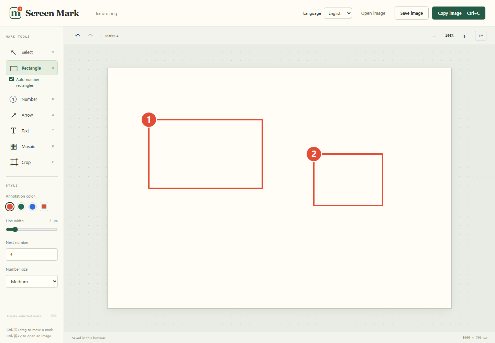
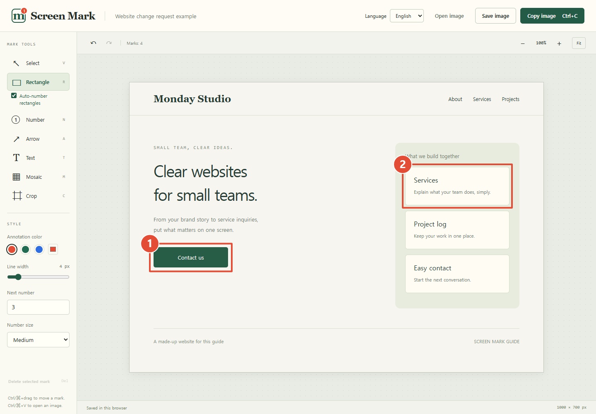

# Screen Mark

English | [한국어](README.ko.md)

A Chrome extension that captures the visible area, a selected region or a full scrolling page, and keeps your clipboard up to date as you mark it with rectangles and numbered labels. Just paste into your AI chat.

MIT licensed. No account or cloud upload required.

## Install

1. Download `screen-mark-<version>.zip` from the [latest release](https://github.com/soloandco/screen-mark/releases/latest) and unzip it. If you cloned the source, use the `extension` folder in the repository.
2. Enter `chrome://extensions` in the Chrome address bar.
3. Turn on **Developer mode** in the top right, then click **Load unpacked**.
4. Select the `screen-mark` folder from the release ZIP, or the `extension` folder from the source. The folder you select must contain `manifest.json`.

Pin Screen Mark from the puzzle icon in the toolbar for quicker access.

To update, save any open work as PNG, replace the files in your installed folder with the new ZIP contents, then click Screen Mark's reload button in `chrome://extensions`. If you installed from source, pull the latest source and click the same button. You do not need to remove the existing extension.



## Language

The default language is English. Choose **English, 한국어, 日本語 or Español** in the capture menu or at the top of the editor. Your choice is saved in this browser and applies immediately to open editors. Images, marks, undo history, the selected tool and zoom are preserved.

The region selection guide uses the language set when the selection starts. See [language support and test coverage](docs/languages.md) for details.

## Quick start

The screenshots below were taken by running the extension itself. The website inside them is a made-up example.

### 1. Choose what to capture

Click the **Screen Mark icon** in the Chrome toolbar.

The installed version appears at the bottom of the menu. After updating a folder, click Screen Mark's reload button in `chrome://extensions` and reopen the menu to check the version.



| Menu item | Use it to |
|---|---|
| **Visible area** | Capture only what is on screen now |
| **Select an area** | Drag over the part of the screen you want |
| **Full page** | Capture a long page as one image |
| Open an image to edit | Edit a saved PNG, JPG or WebP |

**Select an area** starts the selection on the page you are viewing. **Drag and release, and only that part is captured and opened in the editor.** No new tab opens and no image is saved before you select. **Cancel** or `Esc` returns you to the page.



A drag that is too small is not captured, and you can select again. If capturing or saving fails, you can drag again on the same page. Resizing the window cancels the selection. On pages where selection is restricted, such as Chrome settings and the Web Store, use **Visible area**. Selection tabs already open from an earlier version can still be completed.

Only the part you selected is cut out and passed to the editor. Rectangles, numbers, saving and copying then work as usual, but Undo cannot bring back what was outside the selection. To include more than one screen, capture with **Full page** and use **Crop** in the editor.

### 2. Paste it right away

**Every new capture goes straight to your clipboard.** When the status bar shows **Image copied**, press `Ctrl+V` in your AI chat (`⌘+V` on Mac). You do not need to press a copy button.

- Each capture replaces what was on your clipboard, and so does each mark, undo and redo in step 3. To keep your clipboard untouched, uncheck **Copy captures and marks to clipboard automatically** in the menu. The setting is saved in this browser.
- Opening an image file, pasting an image or reloading the editor does not change your clipboard by itself.
- If you switch to another window before the copy runs, it runs when you come back within 10 seconds. After that it is skipped so it cannot replace something you copied elsewhere, and the status bar says so. If a copy is skipped or fails, click **Copy image** or press `Ctrl+C`.

### 3. Mark it up with rectangles and numbers

Click **Rectangle** on the left and drag over what you want to highlight. With **Auto-number rectangles** on, a round number is added to the top left of each box in order: 1, 2, 3. It is on by default. Uncheck it to add rectangles only.



Changes to **Next number** and **Number size** apply to the next box. The **Number** tool shares the same sequence. One Undo removes the new box and its number together, and one Redo restores them. You can then select, move or delete the box and number separately. Auto-numbering does not apply to boxes already drawn, and it turns back on when you open a new editor tab.



To move a mark, **hold Ctrl and drag** (`⌘` on Mac). You keep your current tool, saving two clicks to the **Select** tool and back, which is also still available. To delete a mark, select it and press `Delete`. To undo, press `Ctrl+Z`.

### 4. Paste your marked image into your AI chat

Each change is copied about a third of a second after you make it, with your marks included. When the status bar shows **Image copied**, press `Ctrl+V` in your AI chat. Large images can take longer. The green **Copy image** button at the top right and `Ctrl+C` are still there when you want to copy by hand.


You can send the image with a request like this.

> Make button 1 larger. Change the title of card 2 to "How it works".

To keep a file, click **Save image**. It saves a PNG with your rectangles and numbers included.

## Edit an image from your clipboard

If you copied an image with another tool, such as the Windows screenshot tool, press **Ctrl+V** in the editor (`⌘+V` on Mac). It opens for editing without saving a file or using a file picker. An open image is replaced by the new one. Text fields paste text as usual, and if you have unsaved marks you are asked to confirm first.

## Tools and shortcuts

| Tool | How to use | Key |
|---|---|---|
| Rectangle | Drag to draw an outline. Also adds a number when auto-numbering is on | R |
| Number | Click to add a round number. The next number increases automatically | N |
| Select | Select a mark and drag to move it. Delete removes it | V |
| Arrow | Drag from start to end | A |
| Text | Click a position and type | T |
| Mosaic | Drag over the area to hide | M |
| Crop | Drag over the area to keep. Can be undone | C |

Change color and line width on the left. With a mark selected, they apply to that mark too. Set a number directly in **Next number** and choose its size. `Ctrl+Z` undoes, `Ctrl+Shift+Z` or `Ctrl+Y` redoes, and `Esc` cancels the selection or a drag in progress.

Marks are copied automatically, so paste with `Ctrl+V` in your AI chat. **Copy image** or `Ctrl+C` copies by hand. While you type in a text field, normal text copy still works. **Save image** downloads a PNG at the original resolution with your marks merged in. Zoom only affects the editing view.

## Storage and permissions

Images are never sent to an external server. The original image and your edits are stored in this browser profile's extension IndexedDB. Reloading restores your edits and clears undo history. When you capture, temporary work last saved more than a day ago is deleted. Save images you want to keep as PNG. Removing the extension also removes its stored data.

During a region selection, the full visible area is stored temporarily. Confirming replaces it with the selected part, and **Cancel** or `Esc` deletes the temporary original. If you close a selection tab with X, the temporary original stays until the next capture made more than a day after its last save.

Opening the same capture in two editor tabs is detected as a save conflict. Another tab's saved version is not overwritten, and the conflicting tab's marks stay on screen. Keep them with **Save image** or **Copy image** first, then reload that tab to continue from the latest saved version. If automatic saving has failed and you open a new image, you are asked whether to discard the unsaved marks. Canceling keeps your current work.

- `activeTab`: captures the current tab when you invoke the extension.
- `scripting`: scrolls for full-page capture and avoids duplicating fixed elements. Restores the original position and styles afterward.
- `clipboardWrite`: copies captures and marked images.

While running, the extension uses no always-on access to all sites, no login, no external libraries and no analytics.

## Limitations

- Chrome 120 or later, Manifest V3.
- Full page covers **vertical scrolling** of the currently loaded main content. For pages wider than the window, use **Visible area**.
- Fixed headers and buttons are included on the first screen and hidden on later ones to avoid duplicates.
- Inner scrolling panels, infinite scroll, virtualized lists, video and moving content are not guaranteed to capture completely. Use **Visible area** for complex pages.
- Chrome internal pages and the Web Store, where scripts cannot run, restrict full-page mode.
- Files up to 40 MB, images up to 32,760 px per side and 48 million pixels in total. High-DPI screens can reach the full-page limit sooner.
- Mosaic is a visual cover. Check the actual PNG before sharing anything sensitive, such as passwords.

## Development and testing

Load `extension/` directly. There are no runtime dependencies and no build step. After changing the source, click reload on the extensions page.

Install the development dependencies with Node.js 22 or later. You do not need Node.js to install and use the extension.

```sh
npm ci
npx playwright install chromium
npm test
npm run test:browser
npm run package
```

On Linux, use `npx playwright install --with-deps chromium` if you also need browser system libraries. Browser tests use separate temporary profiles and never touch your Chrome profile. They reproduce a click on the extension icon with CDP `Extensions.triggerAction` to grant activeTab, without changing the permissions in the source manifest. Development dependencies are not included in the extension ZIP.

Test results: `docs/verification.md`. ZIP output: `dist/screen-mark-1.3.0.zip`.

| Command | What it checks |
|---|---|
| `npm run test:interaction` | Automatic copy after capture and after each mark, its off setting, real clipboard image and text paste, modifier drag that keeps the tool, undo, cancelling a paste after a save conflict, and input lock while loading. See the [click-flow review](docs/fewer-clicks.md) (Korean) |
| `npm run test:languages` | English default, order and persistence of the four languages, updates in open editors, preserved edit state, translated errors and accessibility labels, real capture, PNG, clipboard write and existing selection tabs. Older regression tests select Korean explicitly |
| `npm run test:region` | In a separate headless profile of installed Google Chrome: drag selection on the original page, real PNG pixels, editing and clipboard write, cancel and resize, retry after capture or save failure. Set `REGION_SCALE=2` to run at 2x scale. Sample images go to `test-results/region-1/` |
| `npm run test:region-legacy` | Compatibility of selection tabs already open from an earlier version |
| `npm run test:regressions` | Initial image load conflicts, recovering file open after an error, arrow selection, and header and footer pixels in full-page capture. `npm run test:regressions -- --long` adds a 3.2-second delay to each capture on a 32,000 px page to confirm completion past 90 seconds. It takes several minutes and is not a speed benchmark |
| `npm run test:auto-number` | Auto-numbering, undo and redo, sequence shared with manual numbers, placement at edges and after crop, PNG pixels and real clipboard write. See [v1.0.5 results](docs/auto-number/v1.0.5.json) |
| `npm run test:stability` | In a new test profile: repeated capture, multiple editor tabs, save conflicts, cleanup of old work, switching tabs during capture and restarting an idle worker. See the [v1.0.3 stability review](docs/stability.md) (Korean) |

## Performance

The [region capture performance record](docs/performance-region.md) (Korean) keeps the initial measurements and those split by browser stage. `npm run benchmark:region` measures selection, capture, cropping and opening the editor. `node scripts/region-performance-report.mjs` recalculates the report from the published raw results.

v1.0.2 removed a duplicate PNG conversion in visible-area capture and grouped drawing during a drag by screen frame. It reuses one PNG export result while nothing changes and discards it immediately on edit, undo, redo or image replacement. The cache keeps PNGs up to 16 MiB, and repeated copy requests share the work in progress.

The [before-and-after report](docs/performance.md) (Korean) compares capture, opening the editor, dragging, real clipboard copy and memory. It was measured on 2026-10-21 in a separate headless profile of installed Chrome, with the median and range of five runs per version. Memory is an observation of the whole test Chrome, not of the extension alone and not a comparison with other products. [Raw results](docs/benchmarks/2026-10-21.json) are included.

Reproduce the comparison with `npm run benchmark`. It uses installed Google Chrome and a new temporary profile, and Windows memory measurement needs Python 3. By default it alternates five runs each of the earlier public version `d5aed23` and the current `extension/`. Raw results go to `test-results/performance/raw.json`. Set `BENCH_BASELINE`, `BENCH_TRIALS`, `BENCH_OUTPUT` and `BENCH_PYTHON` to choose the baseline commit, number of runs, output path and Python executable.

`node scripts/performance-report.mjs docs/benchmarks/2026-10-21.json docs/performance.md` recalculates the report figures from the published raw results. `node tests/render-mutation.mjs` disables frame grouping, PNG reuse and invalidation one at a time in a temporary copy to confirm the regression tests fail.

To contribute, see [CONTRIBUTING.md](CONTRIBUTING.md).

Retake the README screenshots with `npm run docs:images`. It runs real capture, marking and copying in a separate Chromium that does not use your profile.

## License

[MIT](LICENSE). You may use, modify, redistribute and use it commercially, keeping the copyright and license notice.

This project is not affiliated with Awesome Screenshot and contains none of its code. We have not verified any claim that it uses less memory than other extensions.
