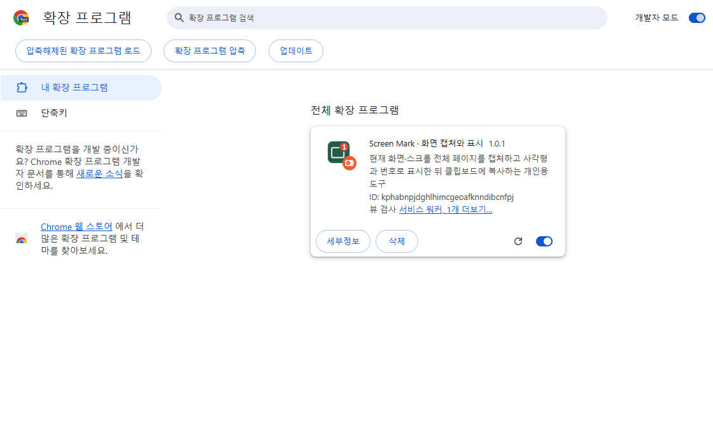
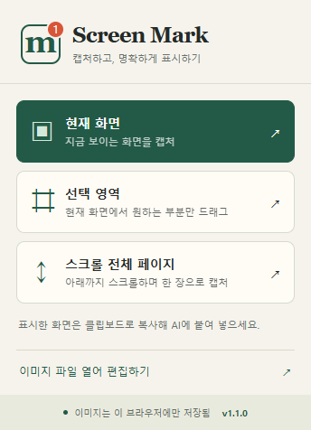
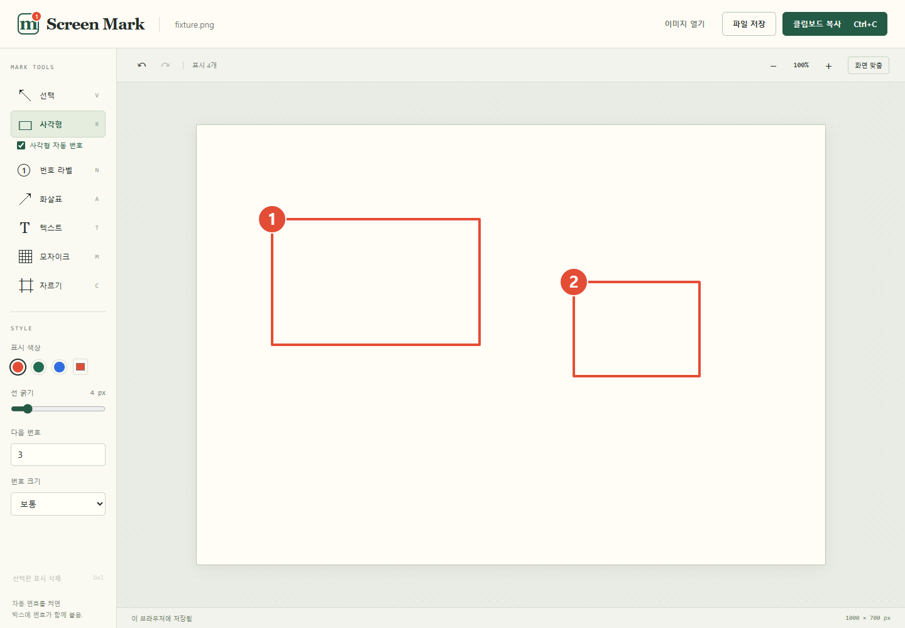
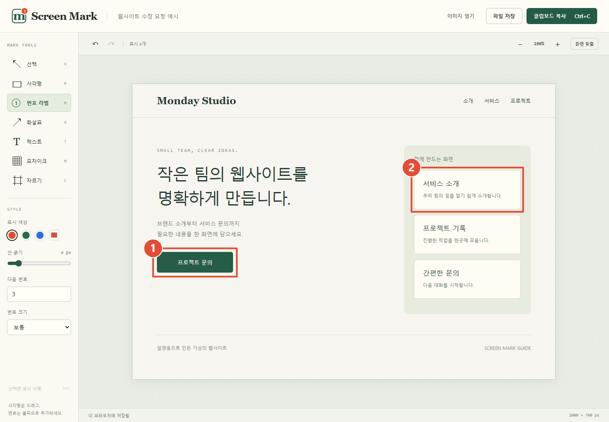

# Screen Mark

현재 화면과 스크롤 전체 페이지를 캡처하고, 사각형·원형 숫자로 표시한 뒤 AI 입력창에 붙여 넣는 크롬 확장 프로그램.

A local Chrome screenshot and annotation extension with numbered labels and clipboard export. MIT licensed. No account or cloud upload required.

## 설치

1. [최신 릴리스](https://github.com/soloandco/screen-mark/releases/latest)에서 `screen-mark-1.0.6.zip`을 내려받아 압축을 푼다. 소스를 받았다면 저장소 안의 `extension` 폴더를 사용한다.
2. Chrome 주소창에 `chrome://extensions`를 입력한다.
3. 오른쪽 위 **개발자 모드**를 켠 뒤 **압축해제된 확장 프로그램을 로드합니다**를 누른다.
4. 릴리스 ZIP에서는 `screen-mark` 폴더, 소스에서는 `extension` 폴더를 선택한다. `manifest.json`이 들어 있는 폴더가 설치 대상이다.

도구 모음의 퍼즐 아이콘에서 Screen Mark를 고정하면 편하다. ZIP으로 받았다면 먼저 압축을 풀고 그 안의 `screen-mark` 폴더(manifest.json이 들어 있는 폴더)를 선택한다.

기존 설치를 업데이트할 때는 열려 있는 편집 작업을 PNG로 보관하고, 설치한 폴더의 파일을 새 ZIP 내용으로 교체한 뒤 `chrome://extensions`에서 Screen Mark의 새로고침 버튼을 누른다. 소스를 설치했다면 최신 소스를 받은 뒤 같은 버튼을 누른다. 기존 확장 항목을 삭제할 필요는 없다.



## 이미지로 따라 하기

아래 이미지는 v1.0.1 확장을 실제로 실행해 촬영했다. 화면 안의 웹사이트는 설명용 예제다.

### 1. 캡처 방식 선택

크롬 도구 모음에서 **Screen Mark 아이콘**을 누른다.

메뉴 하단에 실제 설치된 버전이 표시된다. 업데이트한 폴더를 쓰는 경우 `chrome://extensions`에서 Screen Mark의 새로고침을 누르고 메뉴를 다시 열어 버전을 확인한다.



| 메뉴 | 선택할 때 |
|---|---|
| **현재 화면** | 지금 보이는 부분만 캡처할 때 |
| **스크롤 전체 페이지** | 아래로 긴 웹페이지를 한 장에 담을 때 |
| 이미지 파일 열어 편집하기 | 이미 저장한 PNG·JPG·WebP를 편집할 때 |

### 2. 사각형과 번호로 표시

왼쪽 **사각형**을 누르고 표시할 부분을 드래그한다. **사각형 자동 번호**가 켜져 있으면 박스 왼쪽 위에 1, 2, 3 순서로 원형 번호가 함께 붙는다. 기본으로 켜져 있으며, 체크를 끄면 사각형만 추가된다.



**다음 번호**와 **번호 크기**를 바꾸면 다음 박스에도 적용된다. **번호 라벨** 도구로 직접 추가하는 번호와 같은 순서를 사용한다. 실행 취소 한 번으로 방금 만든 박스와 번호를 함께 지우고, 다시 실행 한 번으로 복원한다. 추가 후에는 박스와 번호를 각각 선택해 이동·삭제할 수 있다. 이미 그린 박스에 소급 적용하지 않으며, 새 편집 탭을 열면 자동 번호가 다시 켜진다.



표시를 옮길 때는 **선택** 도구로 드래그한다. 지우려면 선택 후 `Delete`, 되돌리려면 `Ctrl+Z`를 누른다.

### 3. 복사해서 AI에 붙여 넣기

오른쪽 위 초록색 **클립보드 복사**를 누르거나 `Ctrl+C`를 누른다. 아래 상태줄에 **클립보드에 복사됨**이 표시되면 AI 입력창에서 `Ctrl+V`를 누른다.


이미지와 함께 이렇게 요청할 수 있다.

> 1번 문의 버튼을 더 크게 해줘. 2번 카드의 제목은 '이용 방법'으로 바꿔줘.

파일로 보관할 때는 **파일 저장**을 누른다. 사각형과 번호가 포함된 PNG로 저장된다.

## 도구·단축키

| 도구 | 사용법 | 키 |
|---|---|---|
| 사각형 | 드래그해 테두리 표시. 자동 번호가 켜져 있으면 번호도 함께 추가 | R |
| 번호 라벨 | 화면을 클릭하면 원형 숫자를 추가. 다음 번호 자동 증가 | N |
| 선택 | 표시를 선택해 드래그로 이동. Delete로 삭제 | V |
| 화살표 | 시작점에서 끝점으로 드래그 | A |
| 텍스트 | 위치 클릭 후 문구 입력 | T |
| 모자이크 | 가릴 영역을 드래그 | M |
| 자르기 | 남길 영역을 드래그. 실행 취소 가능 | C |

색상과 굵기는 왼쪽에서 바꾼다. 표시를 선택한 상태에서는 선택한 표시에도 적용된다. 번호는 **다음 번호**에서 직접 지정하고 크기도 선택할 수 있다. `Ctrl+Z`로 실행 취소, `Ctrl+Shift+Z` 또는 `Ctrl+Y`로 다시 실행한다. `Esc`로 선택과 진행 중인 드래그를 취소한다.

**클립보드 복사**가 기본 버튼이다. 표시를 마친 뒤 버튼을 누르거나 `Ctrl+C`로 복사하고 AI 입력창에 `Ctrl+V`로 붙여 넣는다. 텍스트 입력 중에는 일반 텍스트 복사가 유지된다. **파일 저장**은 표시를 합성한 원래 해상도의 PNG를 내려받는다. 확대·축소는 편집 화면에만 적용된다.

## 저장과 권한

이미지를 외부 서버로 보내지 않는다. 원본과 편집 정보는 이 브라우저 프로필의 확장 IndexedDB에 저장된다. 새로고침 시 편집은 복원되며 실행 취소 이력은 초기화된다. 캡처 시 마지막 저장 후 하루가 지난 임시 작업을 삭제한다. 보관할 이미지는 PNG로 저장한다. 확장을 제거하면 내부 저장 데이터도 제거된다.

같은 캡처를 두 편집 탭에서 열면 저장 충돌을 감지한다. 다른 탭의 저장본을 덮어쓰지 않으며, 충돌한 탭의 표시는 현재 화면에 남는다. 해당 탭에서 먼저 **파일 저장** 또는 **클립보드 복사**로 보관한 뒤 새로고침하면 최신 저장본으로 다시 편집할 수 있다. 자동 저장에 실패한 상태에서 새 이미지를 열 때는 미저장 표시를 버릴지 확인한다. 취소하면 현재 작업을 유지한다.

- `activeTab`: 확장 아이콘으로 호출한 현재 탭 캡처.
- `scripting`: 전체 페이지 스크롤과 고정 요소 중복 방지. 캡처 후 원래 위치와 스타일 복원.
- `clipboardWrite`: 편집 이미지 복사.

확장 실행 중에는 전체 사이트 상시 접근 권한, 로그인, 외부 라이브러리, 분석 도구를 사용하지 않는다.

## 지원 범위

- Chrome 120 이상, Manifest V3.
- 전체 페이지는 현재 로드된 본문의 **세로 스크롤** 대상. 가로 초과 페이지는 현재 화면 캡처를 이용한다.
- 고정 헤더·버튼은 첫 화면에 포함하고 후속 화면에서 중복을 숨긴다.
- 내부 스크롤 패널, 무한 스크롤, 가상 목록, 영상·움직이는 콘텐츠는 완전한 전체 캡처를 보장하지 않는다. 복잡한 페이지는 현재 화면 캡처를 이용한다.
- 스크립트를 넣을 수 없는 Chrome 내부 페이지와 웹스토어 등은 전체 페이지 모드가 제한된다.
- 파일은 40MB 이하, 이미지 한 변 32,760px 이하, 전체 4,800만 픽셀 이하. 배율이 높은 화면은 전체 페이지 한도에 먼저 도달할 수 있다.
- 모자이크는 시각적 가림이다. 비밀번호처럼 민감한 정보는 공유 전 실제 PNG 결과를 확인한다.

## 개발·검증

런타임 의존성과 빌드 단계 없이 `extension/`을 로드한다. 소스를 바꾼 뒤 확장 관리 화면에서 새로고침한다.

Node.js 22 이상에서 개발 의존성을 설치한다. 확장을 설치해서 사용하는 데에는 Node.js가 필요하지 않다.

```sh
npm ci
npx playwright install chromium
npm test
npm run test:browser
npm run package
```

Linux에서 브라우저 시스템 라이브러리도 필요하면 `npx playwright install --with-deps chromium`을 사용한다. 브라우저 검사는 별도 임시 프로필만 사용하며 사용자 Chrome 프로필을 건드리지 않는다. CDP `Extensions.triggerAction`으로 확장 아이콘 호출을 재현해 activeTab을 부여한다. 원본 매니페스트의 권한을 바꾸지 않고 테스트한다. 개발 의존성은 확장 ZIP에 포함되지 않는다.

검증 결과: `docs/verification.md`. ZIP 생성 결과: `dist/screen-mark-1.0.6.zip`.

`npm run test:regressions`는 설치된 Google Chrome의 별도 임시 프로필에서 초기 이미지 로딩 충돌, 오류 후 파일 열기 복구, 화살표 선택, 전체 페이지의 헤더·하단 픽셀을 검사한다. `npm run test:regressions -- --long`은 캡처 API에 매회 3.2초 지연을 주입하고 높이 32,000px 페이지를 실제로 32번 촬영해, 90초 이후에도 완료되는지 추가 검사한다. 이 검사는 수 분이 걸리며 속도 벤치마크가 아니다. 단위 테스트는 제어된 시계로 복원 타이머 갱신과 유휴 상태의 원상 복구도 확인한다.

`npm run test:auto-number`는 설치된 Google Chrome의 별도 임시 프로필에서 자동 번호, 실행 취소·다시 실행, 수동 번호와의 순서 공유, 가장자리·자르기 배치, PNG 픽셀과 실제 클립보드 쓰기를 검사한다. [v1.0.5 실행 결과](docs/auto-number/v1.0.5.json)를 공개한다.

`npm run test:stability`는 설치된 Google Chrome의 새 시험용 프로필에서 연속 캡처·다중 편집 탭·저장 충돌·오래된 작업 정리·캡처 중 탭 전환·유휴 worker 재시작을 검사한다. 사용자 프로필은 열지 않는다. [v1.0.3 안정성 검증](docs/stability.md)에 발견한 결함과 검증 범위를 기록한다.

## 성능 개선과 측정

v1.0.2는 현재 화면 캡처의 중복 PNG 변환을 제거하고, 드래그 중 그리기를 화면 프레임 단위로 묶는다. 변경 없는 PNG 내보내기 결과를 한 개만 재사용하며, 편집·실행 취소·다시 실행·이미지 교체 시 즉시 무효화한다. 캐시는 16MiB 이하의 PNG만 유지하며, 연속 복사 요청은 진행 중인 작업을 공유한다.

[변경 전후 실측 보고서](docs/performance.md)에 캡처·편집 화면 표시·드래그·실제 클립보드 복사·메모리를 비교했다. 측정일은 2026-10-21이며, 설치된 Chrome의 별도 headless 프로필에서 버전별 다섯 번 측정한 중앙값과 변동 범위를 공개한다. 메모리는 시험용 Chrome 전체의 관측값이며 확장 단독이나 다른 제품과의 비교 수치가 아니다. [원시 결과](docs/benchmarks/2026-10-21.json)도 포함한다.

전후 측정은 `npm run benchmark`로 재현한다. 설치된 Google Chrome과 새 임시 프로필을 사용하며, Windows 메모리 측정에는 Python 3가 필요하다. 기본값은 이전 공개 버전 `d5aed23`과 현재 `extension/`을 각각 다섯 번 번갈아 실행하는 것이다. 원시 결과는 `test-results/performance/raw.json`에 저장된다. `BENCH_BASELINE`, `BENCH_TRIALS`, `BENCH_OUTPUT`, `BENCH_PYTHON` 환경변수로 기준 커밋·반복 수·출력 위치·Python 실행 파일을 지정할 수 있다.

`node scripts/performance-report.mjs docs/benchmarks/2026-10-21.json docs/performance.md`로 공개 원시 결과에서 보고서 수치를 다시 계산한다. `node tests/render-mutation.mjs`는 임시 사본의 프레임 묶기·PNG 재사용·무효화를 각각 무력화해 회귀 테스트가 실패하는지 확인한다.

기여 방법은 [CONTRIBUTING.md](CONTRIBUTING.md)를 참고한다.

README 화면 이미지는 `npm run docs:images`로 다시 촬영할 수 있다. 사용자 프로필을 사용하지 않는 별도 Chromium에서 실제 캡처·표시·복사를 실행한다.

## 라이선스

[MIT](LICENSE). 사용·수정·재배포·상업적 이용을 허용하며 저작권과 라이선스 고지를 유지해야 한다.

이 프로젝트는 Awesome Screenshot과 제휴하거나 그 제품의 코드를 포함하지 않는다. 다른 확장보다 메모리를 적게 사용한다는 비교 성능 주장은 검증하지 않았다.
